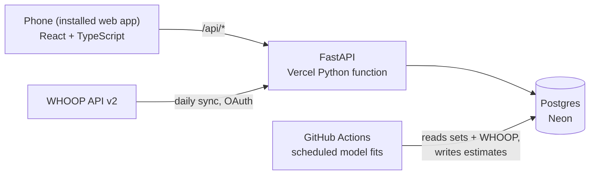

# Lift Tracker

A personal strength-training tracker that runs as a home-screen web app on my phone. It logs every set, pulls daily recovery data from my WHOOP, and applies statistical models to measure how my strength changes over time and what drives it.

**Quant features (roadmap)**
- **Kalman filter** on estimated 1-rep max: separates true strength from day-to-day noise and reports a confidence band
- **Bayesian hierarchical model** of how recovery, HRV and sleep shift performance relative to that baseline
- **Fitness-fatigue (Banister) model** and **plateau detection**

The math is written up in [`docs/math/`](docs/math/README.md).

## Architecture



| Layer | Tech | Why |
|---|---|---|
| Frontend | React, TypeScript, Vite, PWA | Installable on the home screen; caches the app shell for bad gym signal |
| API | Python, FastAPI, SQLAlchemy 2, Pydantic | Typed request validation; the same Python stack as the models |
| Database | Postgres (Neon free tier) | Relational data: workouts → sets → exercises |
| Models | NumPy / SciPy / PyMC (planned) | Run as scheduled jobs, not in the request path, so heavy libraries never slow the app |
| Hosting | Vercel | Static frontend + serverless Python from one repo, deployed on every push |

## Repo layout

```
api/index.py          Vercel entry point; exposes the FastAPI app
backend/app/          FastAPI app: config, db, models, schemas, routes
backend/tests/        pytest suite
frontend/             React app (Vite)
docs/                 Architecture notes and math write-ups
scripts/              One-off utilities (icon generation, imports)
```

## Running locally (Windows)

Prerequisites: Git, Python 3.12+, Node.js LTS.

**Backend** (terminal 1, from the repo root):

```powershell
python -m venv .venv
.venv\Scripts\Activate.ps1
pip install -r requirements-dev.txt
cd backend
uvicorn app.main:app --reload --port 8000
```

With no `DATABASE_URL` set, it uses a local SQLite file, so no database setup is needed. Interactive API docs are at http://localhost:8000/docs.

**Frontend** (terminal 2):

```powershell
cd frontend
npm install
npm run dev
```

Open http://localhost:5173. The dev server forwards `/api` calls to the backend.

Copy `.env.example` to `.env` first; it holds the local login password (`dev-password`).

**Tests:** `cd backend` then `pytest`.

> If PowerShell blocks `Activate.ps1`, run `Set-ExecutionPolicy -Scope CurrentUser RemoteSigned` once.

## Deploying

1. Import the repo at vercel.com/new. `vercel.json` already defines the build, the Python function and the routing.
2. In the Vercel project, open **Storage → Create → Neon** (free). This sets `DATABASE_URL` automatically.
3. In **Settings → Environment Variables**, add `APP_PASSWORD` (the login password) and `SESSION_SECRET` (a random string, e.g. from `python -c "import secrets; print(secrets.token_urlsafe(32))"`).
4. Redeploy. Every push to `main` deploys again.
5. On the phone, open the site and choose **Add to Home Screen**.

## Security

Single-user password login. The password exists only as a Vercel environment variable. A successful login sets an HttpOnly, SameSite=Lax cookie holding an HMAC-SHA256-signed token with a 1-day expiry, checked on every private route without any server-side session storage. Comparisons are constant-time, failed logins are delayed, and missing configuration fails closed. See [`backend/app/auth.py`](backend/app/auth.py).

## Roadmap

- [x] **Phase 0:** scaffold, data model, CI, deploy pipeline, installable app shell
- [x] **Home screen:** holographic body map; muscles shade red after training and fade over 3 days ([math](docs/math/muscle-recovery.md)); WHOOP stat panels
- [ ] **Phase 1:** workout logging, exercise library, calendar day view, "last time" targets, single-user login, offline set queue
- [ ] **Phase 2:** WHOOP OAuth and daily sync (recovery, HRV, sleep, strain, steps)
- [ ] **Phase 3:** e1RM estimation and Kalman filter with confidence bands
- [ ] **Phase 4:** Bayesian readiness model
- [ ] **Phase 5:** fitness-fatigue model and plateau detection
